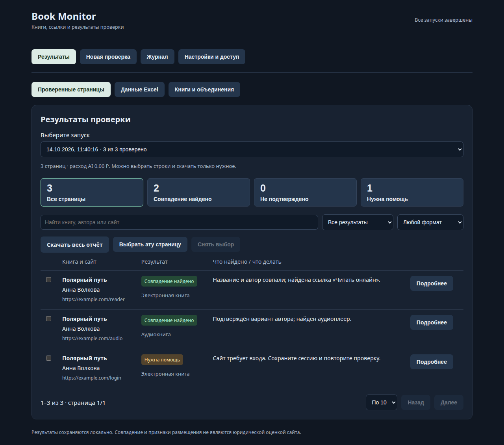
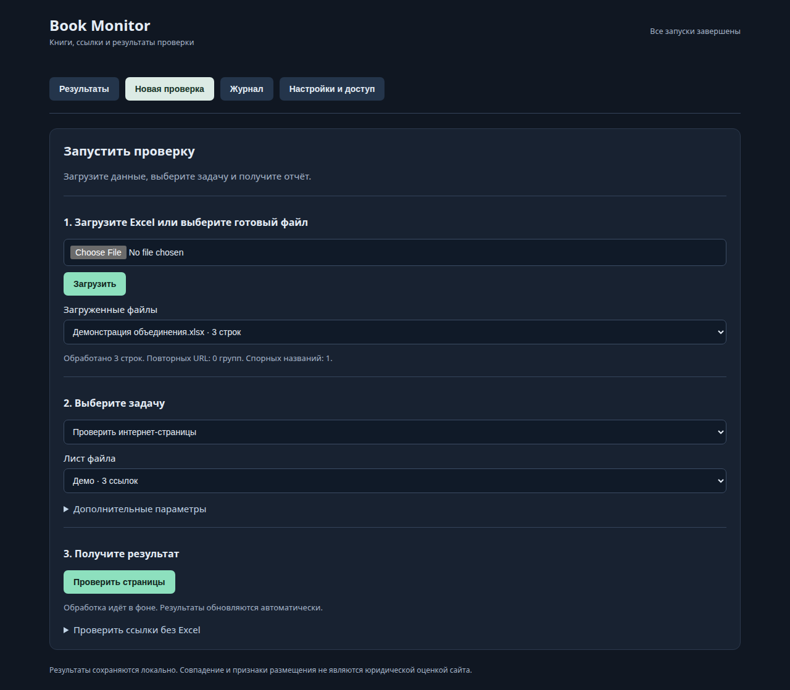
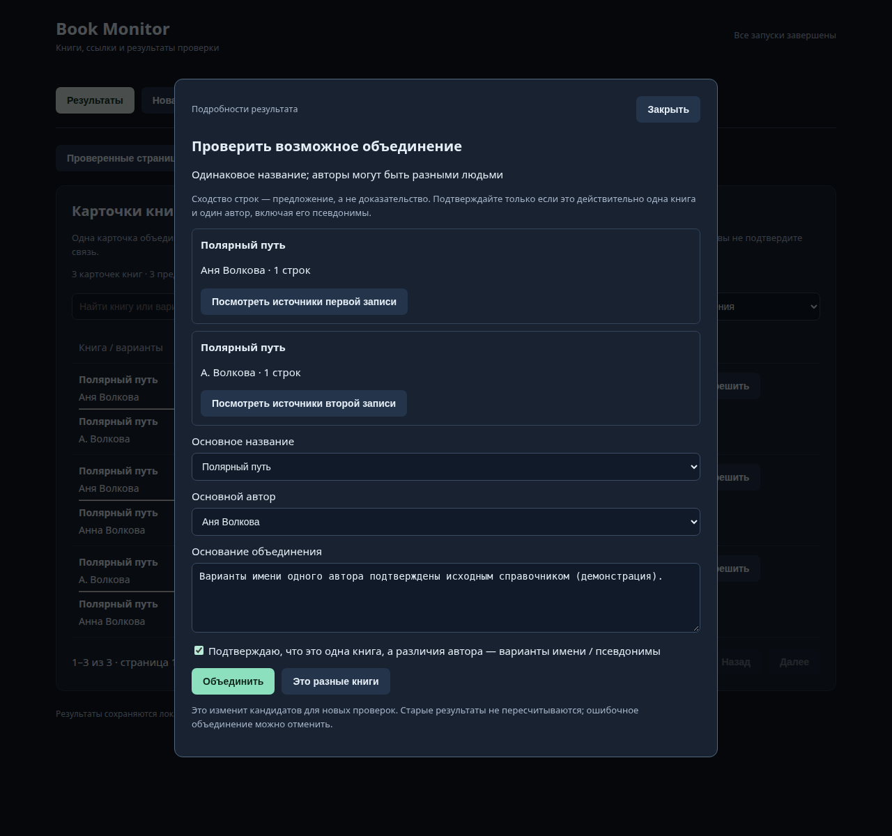
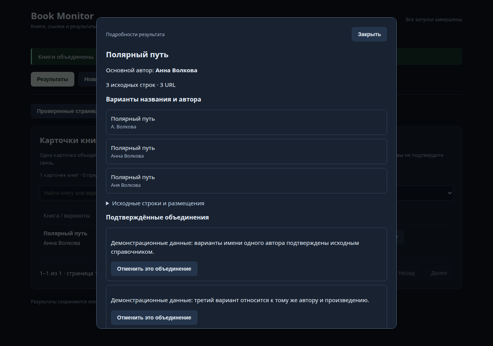
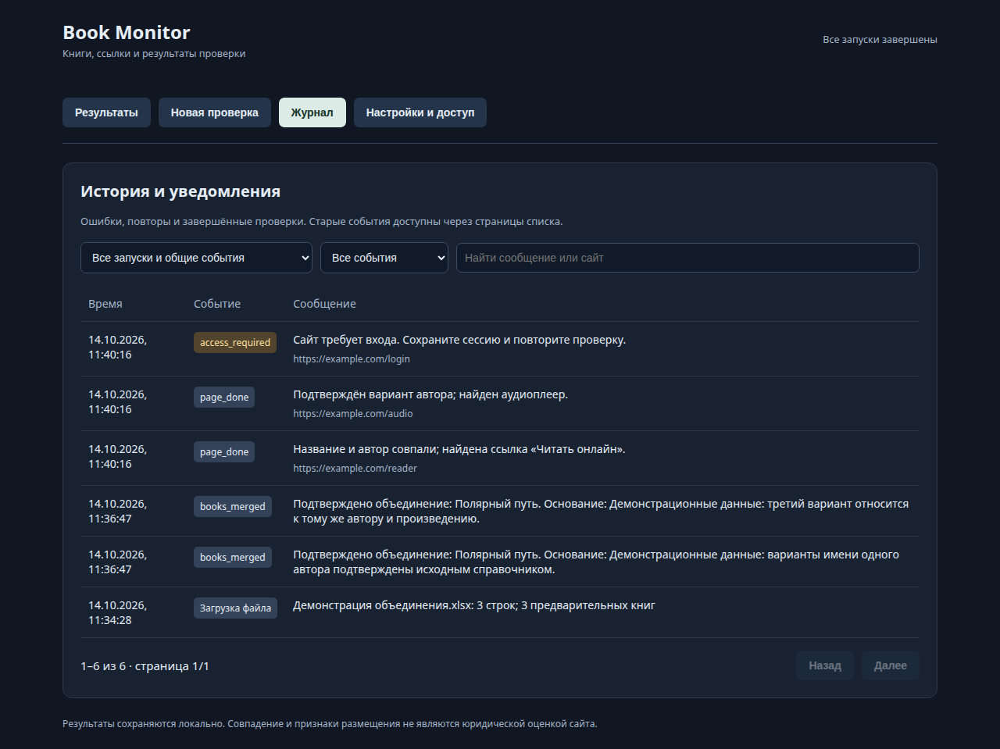
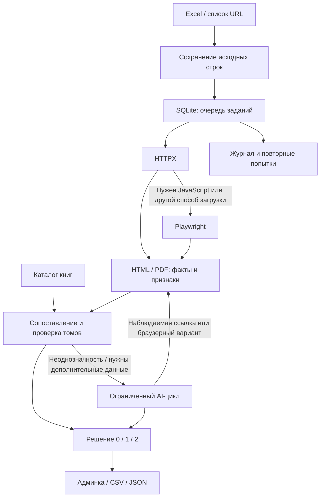

# Book Monitor

**Локальный сервис для сопоставления книг и проверки признаков размещения контента на интернет-страницах.**

[](https://github.com/artemius125/book-monitor/actions/workflows/tests.yml)


Excel со списком книг и URL → сохранение исходных строк → сопоставление с каталогом → проверка страниц → отчёт с причинами и доказательствами.

Работает из терминала, через REST API и веб-админку. Обычные случаи обрабатывает код; AI подключается к неоднозначным данным и сложным страницам. LangChain/LangGraph не требуются: агентский цикл ограничен и написан явно.



*Скриншот содержит демонстрационные данные. В результатах можно выбрать запуск, найти книгу или сайт, отфильтровать аудиокниги и скачать только отмеченные строки. Списки разбиты на страницы.*

## Для проверяющего

1. [Запустите сервис](#быстрый-запуск) без API-ключа.
2. Создайте демо-Excel: `.venv/bin/python examples/make_demo.py`.
3. Откройте админку, загрузите `data/demo.xlsx` и посмотрите **Данные Excel**: исходные строки, повторные URL и одинаковые названия у разных авторов.
4. Загрузите собственный список реальных URL и запустите проверку страниц. Адреса `example.com` в демо-файле служат шаблоном, а не реальными размещениями книг.
5. При необходимости подключите AI; ключ передаётся отдельно и хранится локально.

Подробности: [архитектура](docs/architecture.md) · [проверка и ограничения](VERIFICATION.md) · [каталог-пример](examples/catalog.json).

## Админка в действии

Четыре основных сценария: загрузить файл, разобраться с вариантами одной книги, посмотреть её источники и проверить историю обработки. Все скриншоты сделаны на вымышленных данных; результаты страниц показаны как демонстрация интерфейса.

### Запуск проверки

Три шага: выбрать Excel, задать задачу и запустить обработку. Дополнительные параметры доступны по необходимости.



### Решение неоднозначностей

Выберите основные название и автора, укажите основание и подтвердите объединение. Исходные варианты сохраняются для поиска.



<details>
<summary><strong>Карточка книги: варианты, источники и отмена объединения</strong></summary>



</details>

<details>
<summary><strong>Журнал: результаты обработки и уведомления</strong></summary>

Поиск, фильтр событий и страницы списка помогают найти нужную ошибку или завершённую проверку.



</details>

## Что умеет

| Возможность | Результат |
|---|---|
| Импорт Excel | Исходные значения, лист и номер строки сохраняются; повторный импорт идемпотентен |
| Обработка данных | Дубли URL, предполагаемые связи с книгами, неоднозначности авторов и названий |
| Карточки и объединения | Все исходные варианты и URL одной книги; подтверждение / отклонение похожих записей, отмена объединения |
| Сопоставление | Кандидаты RapidFuzz, проверка автора и номера тома, книги внутри сборников |
| Загрузка страниц | HTTPX, Playwright при необходимости, извлечение текста PDF |
| Признаки контента | Читалки, ссылки FB2/EPUB/PDF/TXT/torrent, аудиоплееры и некоторые списки глав |
| AI | JSON с фактами и цитатами; ограниченные переходы по наблюдаемым ссылкам |
| Ошибки | Классификация, ограниченные повторы, уведомления, ручное восстановление доступа |
| Результаты | CSV/JSON, исходная строка, признаки размещения, причина решения, история |
| Контроль расходов | Баланс AI Tunnel, лимиты, стоимость вызовов, кэш одинаковых запросов |

## Быстрый запуск

Основной локальный вариант рассчитан на **Linux и Python 3.12+**. Docker позволяет запускать Linux-окружение и на других системах. Системные библиотеки Chromium могут потребовать дополнительной установки; Playwright сообщает о недостающих зависимостях.

```bash
git clone https://github.com/artemius125/book-monitor.git
cd book-monitor
python3 -m venv .venv
.venv/bin/pip install -r requirements.lock
.venv/bin/pip install --no-deps -e .
PLAYWRIGHT_SKIP_BROWSER_GC=1 .venv/bin/playwright install chromium
cp .env.example .env
./run.sh
```

- **Админка:** [http://127.0.0.1:8765](http://127.0.0.1:8765)
- **OpenAPI / Swagger:** [http://127.0.0.1:8765/docs](http://127.0.0.1:8765/docs)
- **Проверка состояния:** `GET /api/health`

В `.env.example` AI выключен. Для импорта, поиска дублей и обычных правил проверки платный API не требуется. Если сложный случай не удалось разрешить без AI, сервис сохраняет неопределённость.

### Docker

```bash
cp .env.example .env
docker compose up --build -d
docker compose logs -f
```

Для AI с локальным файлом ключа:

```bash
export AI_KEY_FILE="$PWD/secrets/aitunnel.key"
docker compose -f compose.yaml -f compose.ai.yaml up --build -d
```

Ключ монтируется как Docker secret и не включается в образ. Контейнерная конфигурация подготовлена; проверенный запуск — локальное Python-окружение. Порт публикуется только на localhost.

## Вход и выход

### Вход

Excel `.xlsx` с заголовками в первой строке и следующими **шестью столбцами в указанном порядке**:

| Правообладатель | Автор | Название | Тип контента | URL | Сайт |
|---|---|---|---|---|---|
| Демо | Анна Волкова | Хроники Севера. Книга I | ebook | https://example.com/book-one | example.com |

Дополнительные столбцы сохраняются в исходных данных. Можно загрузить несколько листов; для запуска выбирается нужный лист. Вместо Excel допустим отдельный список URL в админке или API.

Эталонный каталог загружается отдельно как JSON:

```json
[
  {"id":"north-1","title":"Хроники Севера. Книга I","author":"Анна Волкова","format":"ebook"}
]
```

Без эталонного каталога используются **предварительные записи из Excel**. Исходный автор или название при этом не считаются доказательством содержимого страницы.

### Объединение дублей и варианты автора

В **Результаты → Книги и объединения** точные дубли показаны одной карточкой с исходными вариантами и URL. Фильтр «Предложения объединения» находит похожие названия / написания автора и одинаковые названия у разных авторов. Это предложения, а не автоматические решения.

Откройте «Сравнить и решить», изучите источники, выберите основные название и автора, укажите основание и подтвердите связь. Все подтверждённые варианты участвуют в последующем сопоставлении страниц и книг внутри сборников. Противоречия томов / значимых чисел блокируют объединение; эталонные ID не переопределяются. Разные произведения можно отметить кнопкой «Это разные книги». Отменить объединение можно из карточки книги.

Исходные ячейки не меняются. Обработанная таблица сохраняет прежний `book_id` и добавляет `canonical_book_id`, `canonical_title`, `canonical_author`. Неоднозначность снимается только если все связанные записи действительно объединены. Решения сохраняются при повторном импорте того же файла. Старые результаты проверки страниц остаются историческими; для проверки с новыми связями запустите повтор. Замена предварительного каталога эталонным очищает прежние ручные связи, поскольку они относятся к прежним ID.

### Выход

**Обработанная таблица:** исходные значения, ID строки, предполагаемый ID книги, связанные строки, дубли URL, замечания. Разные URL одной книги сохраняются как разные размещения.

**Проверка страницы:** URL, HTTP-статус, извлечённые название/автор/формат, сопоставленная книга, признаки контента, статус и причина. Сохраняются цитаты, адреса источников и шаги проверки.

| Статус | Значение |
|---|---|
| `1` | Книга сопоставлена и найдены признаки размещения |
| `0` | В доступной странице совпадение / размещение не подтверждено |
| `2` | Доступ, извлечение или неоднозначность не позволили определить результат |

**Режимы:** `work` сопоставляет произведение независимо от ebook/аудио; `format` требует исходный формат. Отличие формата всегда отмечается.

Пример сокращённого JSON-результата на вымышленных данных:

```json
{
  "url": "https://example.com/book-one",
  "http_status": 200,
  "status": 1,
  "reason": "Автор и название совпали; найдены признаки размещения",
  "extracted": {
    "title": "Хроники Севера. Книга I",
    "author": "Анна Волкова",
    "format": "ebook",
    "evidence": [{"kind":"reader_link","quote":"Читать онлайн","url":"https://example.com/reader"}]
  }
}
```

## Как устроено



AI получает текст страницы и несколько кандидатов, возвращает JSON по схеме. Цитаты проверяются на присутствие в тексте. Максимум два AI-шага на страницу; модель не выполняет произвольный Python-код и не получает API-ключ в контексте. Финальное решение формируется кодом по проверенным фактам.

| Компонент | Назначение |
|---|---|
| `monitor/ingest.py` | Импорт и сохранение связей с источником |
| `monitor/grouping.py` | Карточки, подтверждённые варианты, объединение и отмена |
| `monitor/matching.py` | RapidFuzz, авторы, тома и сборники |
| `monitor/fetch.py`, `extract.py` | HTTP, браузер, извлечение признаков |
| `monitor/ai.py` | Модели, валидация ответа, баланс и бюджеты |
| `monitor/engine.py`, `store.py` | Агентский цикл, очередь, повторы, SQLite |
| `monitor/api.py`, `cli.py` | API и команды терминала |
| `monitor/static/index.html` | Админка с фильтрами, выбором и страницами |

## Подключение AI

1. Поместите ключ API в локальный файл, например `secrets/aitunnel.key`. Каталог `secrets/` исключён из Git.
2. В `.env` задайте:

```dotenv
MONITOR_AI_ENABLED=true
MONITOR_AI_BASE_URL=https://api.aitunnel.ru/v1
MONITOR_AI_KEY_FILE=secrets/aitunnel.key
MONITOR_AI_MODEL=gpt-4.1-mini
MONITOR_VISION_MODEL=gpt-4.1
```

3. Перезапустите сервис.

По умолчанию: 10 ₽ на скользящие 24 часа, 5 ₽ на запуск проверки, остановка AI при балансе ниже 20 ₽. Цена проверяется по каталогу AI Tunnel, фактический расход берётся из ответа API. Диагностика снимка сильной моделью запускается отдельно и также учитывает бюджет.

Другой OpenAI-совместимый провайдер настраивается через `MONITOR_AI_BASE_URL`, модель и файл ключа. Для провайдера без AI Tunnel balance API установите `MONITOR_AI_BALANCE_PATH=` и задайте цены через `MONITOR_AI_PROMPT_PRICE` / `MONITOR_AI_COMPLETION_PRICE` в ₽ за 1 млн токенов. Совместимость конкретных провайдеров требует проверки; текущая интеграция проверена с AI Tunnel.

## Команды терминала

```bash
.venv/bin/book-monitor import input.xlsx
.venv/bin/book-monitor run IMPORT_ID --sheet 'Книги'
.venv/bin/book-monitor run IMPORT_ID --sheet 'Книги' --scope format
.venv/bin/book-monitor status
.venv/bin/book-monitor export JOB_ID --output result.csv
.venv/bin/book-monitor balance
.venv/bin/book-monitor session 'https://example.com/book'
```

`serve` и `run` не работают одновременно с одной базой: блокировка защищает очередь от двух владельцев. При работающем сервере запускайте проверки через админку или API.

## API

| Метод | Назначение |
|---|---|
| `POST /api/imports` | Excel как multipart `file` |
| `GET /api/imports/{id}/records` | Исходные строки и связи |
| `GET /api/imports/{id}/report.csv` | Обработанная таблица |
| `POST /api/catalog` | Эталонный каталог JSON |
| `GET /api/book-groups` | Карточки книг и предложения объединения |
| `GET /api/book-groups/{id}` | Варианты, источники и история объединений |
| `POST /api/book-merges` | Подтверждение связи с основанием и выбором основных полей |
| `POST /api/book-merges/{source_id}/undo` | Отмена объединения |
| `POST /api/book-merge-reviews/{pair_id}` | Отклонить или вернуть предложение на проверку |
| `POST /api/jobs` | Импорт/лист или список URL |
| `GET /api/jobs/{id}` | JSON результатов |
| `GET /api/jobs/{id}/report.csv` | CSV; параметры `task_id` ограничивают экспорт выбранными строками |
| `POST /api/tasks/{id}/retry` | Ручной повтор с обновлением страницы |
| `POST /api/tasks/{id}/diagnose` | AI-диагностика снимка препятствия |
| `POST /api/sessions/{domain}` | Загрузка Playwright storage_state |
| `GET /api/event-history` | Журнал: страницы, запуск, уровень, поиск |
| `GET /api/balance` | Баланс провайдера и локальный расход |

## Тестирование

```bash
.venv/bin/pytest -q
```

Обычные тесты не требуют API-ключа, доступа к сторонним сайтам или установки браузера. Необязательный тест оригинального приложения включается через `BOOK_MONITOR_TEST_WORKBOOK`; без него тест пропускается. В GitHub Actions выполняются тесты и компиляция Python. Проверяются обработка строк, неоднозначности, тома, сборники, ошибки доступа, повторы, лимиты AI, кэш, экспорт выбранных результатов и журнал за пределами первых 200 событий.

## Ограничения

- Сервис проверяет **переданные URL**, самостоятельного веб-поиска нет.
- Определяются **признаки** размещения. Аудио не прослушивается, доступность полного скачивания не подтверждается, законность размещения не устанавливается.
- CAPTCHA и регистрация требуют участия человека. Доступны диагностика снимка, сохранение ручной сессии и повтор; автоматический обход защиты не реализован.
- Сканированные PDF требуют отдельного OCR. Универсальный DOM-парсер не гарантирует полноту на каждом сайте.
- Это локальный прототип с одним владельцем SQLite-очереди. Публично выставлять админку без аутентификации нельзя.

План перехода к миллиону URL, подход к контролю качества и границы AI описаны в [архитектуре](docs/architecture.md#масштабирование-часть-3).

## Секреты и данные

`.env`, файлы ключей, сессии, SQLite, логи и отчёты находятся вне Git и Docker build context. В репозитории — код, конфигурация-пример, синтетические примеры и документация. Ключи для проверки следует передавать отдельно; GitHub-токен проверяющему для запуска сервиса не нужен.
